# IMPROVEMENTS.md: Upstream LazyVim Parity & Architecture Roadmap

This document provides a comprehensive technical comparison between **[lazyvim-nix](file:///home/muhammadtalha/lazyvim-nix)** and upstream **[LazyVim](https://www.lazyvim.org/)** (repository [LazyVim/LazyVim](https://github.com/LazyVim/LazyVim) and [LazyVim/starter](https://github.com/LazyVim/starter)), detailing the architecture divergence, current gaps, and an actionable roadmap required for `lazyvim-nix` to achieve and actively maintain parity with upstream LazyVim.

---

## 1. Executive Summary & State of Parity

`lazyvim-nix` delivers a declarative, reproducible Nix flake for LazyVim. Instead of downloading plugins, LSP servers, and Tree-sitter parsers imperatively into mutable directories (`~/.local/share/nvim`), `lazyvim-nix` constructs a pure `/nix/store` environment, links plugins through an isolated dev-path directory, pre-builds Tree-sitter grammars, and manages external CLI tools through Nix derivations.

```mermaid
flowchart LR
    subgraph Upstream ["Upstream LazyVim (Imperative / Mutable)"]
        direction TB
        U1["lazy.nvim clones to ~/.local/share/nvim/lazy"]
        U2["mason.nvim downloads binaries to ~/.local/share/nvim/mason/bin"]
        U3["tree-sitter CLI compiles .so into ~/.local/share/nvim/site/parser"]
        U4[":LazyExtras writes import statements to lua/config/lazy.lua"]
    end

    subgraph LazyVimNix ["lazyvim-nix (Declarative / Immutable)"]
        direction TB
        N1["Nix derivations symlinked into synthetic dev-path with dev = true"]
        N2["Mason disabled (enabled = false); tools provided via extraPackages"]
        N3["Parsers pre-built in Nix store and symlinked to site/parser"]
        N4["Extras enabled declaratively via programs.lazyvim.extras.*"]
    end

    Upstream -.->|Automated daily sync via update-plugins.sh| LazyVimNix
```



### Current Parity Rating
* **Core Runtime & Plugins:** **95% Parity**. Tracks release tags (currently `v16.0.1`), starter commit `803bc18`, and accurately loads core LazyVim plugins in dev mode.
* **Extras System:** **90% Parity**. Supports 11 extra categories and nested extras, but suffers from mapping gaps for newer plugins and missing CLI dependencies.
* **Mason Replacement & Tooling:** **98% Parity**. Disables Mason completely while automatically installing all required LSPs, linters, formatters, and runtime dependencies from Nixpkgs by default (`installDependencies = true; installRuntimeDependencies = true`).
* **Platform & Packaging Flexibility:** **70% Parity**. Only supports Home Manager (`programs.lazyvim`); lacks a system-level NixOS module and a standalone wrapped Neovim derivation (`packages.${system}.lazyvim`).

---

## 2. Upstream LazyVim Evolution (v14 -> v15 -> v16+)

Upstream LazyVim has undergone major architectural changes across its recent release cycles:

### 2.1. Neovim >= 0.11.2 Migration & LSP Architecture
* **Native `vim.lsp.config`:** Upstream dropped compatibility code for Neovim `< 0.11.2`. LSP servers are configured natively rather than through deprecated `nvim-lspconfig` wrapper idioms.
* **LSP-Based Folding:** Upstream enabled LSP-driven code folding by default (`nvim-lspconfig.folds.enabled`).
* **Mason 2.x Ecosystem:** Upstream migrated to `mason.nvim` and `mason-lspconfig.nvim` v2.x.

### 2.2. The `snacks.nvim` Revolution
Upstream LazyVim migrated central components from fragmented third-party plugins into [folke/snacks.nvim](https://github.com/folke/snacks.nvim):
* **Picker & Explorer:** `snacks.picker` is now the default picker for new setups; `fzf-lua` and `telescope` are relegated to optional extras. `snacks.explorer` provides native file exploration.
* **Notifier & Dashboard:** `Snacks.notifier` replaced `nvim-notify`; `Snacks.dashboard` replaced `dashboard-nvim` / `alpha-nvim`.
* **Terminal & Buffer Removal:** `Snacks.terminal` replaced `lazyterm`; `Snacks.bufdelete` replaced `mini.bufremove`.
* **Editor Polish:** Native modules for `snacks.input`, `snacks.scroll`, `snacks.indent` (replacing `indent-blankline`), `snacks.scope`, `snacks.dim`, `snacks.zen`, `snacks.zoom`, and `snacks.profiler` (`<leader>dp`).

### 2.3. Completion Engine Transition
* Upstream set **`saghen/blink.cmp`** as the default completion engine, deprecating `nvim-cmp` to the optional `coding.nvim-cmp` extra.
* Cmdline completions are enabled via `blink.cmp`.

### 2.4. Extras Catalog Expansion
* **AI Enhancements:** Added `ai.avante`, `ai.claudecode`, `ai.copilot`, `ai.copilot-chat`, `ai.copilot-native`, `ai.sidekick`, `ai.supermaven`, `ai.codeium`, and `ai.tabnine`.
* **Languages & Formats:** Added or updated `lang.typst`, `lang.gleam`, `lang.angular`, `lang.svelte`, `lang.astro`, `lang.sql`, `lang.php`, and `lang.nushell`.
* **TypeScript Evolution:** Migrated from `tsserver` to `vtsls`, and recently added `tsc` type checking.

### 2.5. Tree-sitter Main Branch Migration
* Upstream transitioned to `nvim-treesitter` on the `main` branch.
* Incremental selection was migrated from `nvim-treesitter` to `flash.nvim`.
* The upstream framework expects the `tree-sitter` CLI to be available for runtime compiling when parsers are missing.

---

## 3. Comprehensive Gap Analysis

The following gaps currently exist between `lazyvim-nix` and upstream LazyVim:

```
┌────────────────────────────────────────────────────────────────────────┐
│                        GAP SEVERITY BREAKDOWN                          │
├───────────────────┬────────────────────────────────────────────────────┤
│ 🔴 Critical       │ G-1 (Unmapped Plugins), G-2 (Starter Patcher Frag) │
├───────────────────┼────────────────────────────────────────────────────┤
│ 🟡 High Priority  │ G-3 (Standalone Package), G-4 (Mason Disabled UX), │
│                   │ G-5 (Neovim Package Customization)                 │
├───────────────────┼────────────────────────────────────────────────────┤
│ 🔵 Medium Priority│ G-6 (Test Isolation), G-7 (TS Manifest Coherence), │
│                   │ G-8 (Tool Mapping Completeness - RESOLVED)         │
└───────────────────┴────────────────────────────────────────────────────┘
```

### [G-1] Unmapped Plugins in `data/mapping-analysis-report.md`
* **Status:** 7 plugins are unmapped in `data/plugins.json`:
  1. `nvim-mini/mini.snippets`
  2. `nvim-mini/mini.files`
  3. `nvim-mini/mini.animate`
  4. `nvim-mini/mini.hipatterns`
  5. `zbirenbaum/copilot.lua`
  6. `alker0/chezmoi.vim`
  7. `xvzc/chezmoi.nvim`
* **Impact:** For unmapped plugins, `resolvePlugin` falls back to automatic regex guessing or `builtins.fetchGit` without SHA256 hashes. If nixpkgs packages these under different names (e.g. `copilot-lua` or `mini-nvim` multi-modules), plugin loading fails or degrades reproducibility.
* **Fix Required:** Add explicit multi-module entries for `nvim-mini/*` pointing to `mini-nvim` with their corresponding `module` names, and standard string mappings for `zbirenbaum/copilot.lua` -> `copilot-lua` in `data/mappings.json`.

### [G-2] Starter Patcher Exact-String Matching Fragility
* **Status:** In [starter-patcher.nix](file:///home/muhammadtalha/lazyvim-nix/nix/lib/starter-patcher.nix#L49-L55), patching relies on exact string equality:
  ```nix
  upstreamSpecPattern = "  spec = {\n    -- add LazyVim and import its plugins\n    { \"LazyVim/LazyVim\", import = \"lazyvim.plugins\" },\n    -- import/override with your plugins\n    { import = \"plugins\" },\n  },";
  upstreamCheckerPattern = "  checker = {\n    enabled = true, -- check for plugin updates periodically\n    notify = false, -- notify on update\n  }, -- automatically check for plugin updates";
  ```
* **Impact:** If upstream `LazyVim/starter` changes a comment, re-indents, or adds a default option, `builtins.replaceStrings` silently fails to match, triggering a hard assertion error:
  `ERROR: Failed to patch LazyVim starter spec section.`
* **Fix Required:** Implement resilient regex or token-based patching that handles variable indentation and minor comment alterations, with a safe fallback template.

### [G-3] Absence of Standalone Wrapped Neovim Package & NixOS Module
* **Status:** `lazyvim-nix` exposes only Home Manager modules (`homeManagerModules.default`).
* **Impact:** Users cannot run `nix run github:pfassina/lazyvim-nix` or install LazyVim system-wide via `nixosModules.lazyvim` in `/etc/nixos/configuration.nix`. Testing requires a full Home Manager evaluation.
* **Fix Required:**
  1. Export `packages.${system}.lazyvim` and `packages.${system}.default` using `pkgs.wrapNeovimUnstable`.
  2. Export `nixosModules.lazyvim` / `nixosModules.default` that wraps the Neovim package with LazyVim's patched `init.lua`, runtime directories, and parsers.

### [G-4] Silent Failure from Disabled Mason
* **Status:** In [starter-patcher.nix](file:///home/muhammadtalha/lazyvim-nix/nix/lib/starter-patcher.nix#L16-L18), Mason is forcefully disabled:
  ```lua
  { "mason-org/mason.nvim", enabled = false },
  { "mason-org/mason-lspconfig.nvim", enabled = false },
  { "jay-babu/mason-nvim-dap.nvim", enabled = false },
  ```
* **Impact:** In upstream LazyVim, opening a Python or Rust file triggers Mason to prompt and auto-install `pyright`/`ruff` or `rust-analyzer`. In `lazyvim-nix`, if the user has `installDependencies = false` (the default!), nothing happens. No LSP attaches, and no warning explains why.
* **Fix Required:** Inject a lightweight Lua notification hook via `_lazyvim_nix_mason_stub.lua` that intercepts Mason commands (`:Mason`, `:MasonInstall`) or warns when an LSP server configured in `lspconfig` is missing from `PATH`, providing the exact Nix config needed (e.g. `programs.lazyvim.extras.lang.python.installDependencies = true`).

### [G-5] Neovim Package Customization & Version Assertions
* **Status:** [module.nix](file:///home/muhammadtalha/lazyvim-nix/nix/module.nix#L220) hardcodes:
  ```nix
  package = pkgs.neovim-unwrapped;
  ```
* **Impact:** Users cannot provide `pkgs.neovim-nightly` or custom-compiled Neovim binaries. Additionally, since upstream LazyVim requires `neovim >= 0.11.2`, evaluating against older nixpkgs channels (like `nixos-24.05` or older `nixos-24.11` releases) fails silently or causes subtle runtime Lua errors.
* **Fix Required:** Expose `programs.lazyvim.package` option (defaulting to `pkgs.neovim-unwrapped`) and add an evaluation assertion checking `lib.versionAtLeast cfg.package.version "0.11.2"`.

### [G-6] Test Runner Host Environment Contamination
* **Status:** [test/run-tests.sh](file:///home/muhammadtalha/lazyvim-nix/test/run-tests.sh#L213-L215) executes:
  ```bash
  run_individual_test "data/plugins.json is valid JSON" "jq empty '$PROJECT_ROOT/data/plugins.json'"
  ```
* **Impact:** Running `./test/run-tests.sh` on a machine without host `jq` fails 3 tests immediately, even when the Nix code evaluates perfectly.
* **Fix Required:** Make `test/run-tests.sh` invoke `nix develop --command` or locate `jq` from the Nix store.

### [G-7] Tree-sitter Parser Manifest & Query Synchronization
* **Status:** Upstream `nvim-treesitter` on `main` frequently updates parser revisions and query files. [treesitter.nix](file:///home/muhammadtalha/lazyvim-nix/nix/lib/treesitter.nix) builds parsers from [data/parser-manifest.json](file:///home/muhammadtalha/lazyvim-nix/data/parser-manifest.json).
* **Impact:** When `pluginSource = "latest"`, any newly introduced Tree-sitter parser not present in `parser-manifest.json` triggers a hard throw. Furthermore, if query files reference newer parser APIs, grammar mismatches can cause syntax highlighting breakage.
* **Fix Required:** Add automated weekly verification in CI that builds a canary set of parsers against the pinned queries and verifies `tree-sitter` CLI version compatibility.

### [G-8] System Dependency Mapping Completeness for New Extras [RESOLVED]
* **Status:** **RESOLVED.** [scripts/extract-dependencies.lua](file:///home/muhammadtalha/lazyvim-nix/scripts/extract-dependencies.lua) and [data/dependencies.json](file:///home/muhammadtalha/lazyvim-nix/data/dependencies.json) now provide exhaustive 1:1 mappings for all language servers, linters, formatters, debuggers, and runtime tools across all LazyVim extras, verified against `nixpkgs`. Furthermore, `installDependencies` and `installRuntimeDependencies` default to `true` for all extras, making tool installation fully automatic and production-ready.
* **Resolution Details:**
  - Resolved 114 package paths across 62 tool-requiring extras (including `tinymist`, `typstyle`, `biome`, `vtsls`, `claude-code`, `snacks_picker` tools `chafa`/`gh`, etc.).
  - Purged spurious table keys and non-tool identifiers (`has`, `jump1`, `ignore_current_line`, etc.).
  - Added unit and integration tests verifying default auto-installation and opt-out mechanics.

---

## 4. Prioritized Actionable Roadmap

```mermaid
gantt
    title LazyVim-Nix Parity Implementation Roadmap
    dateFormat  X
    axisFormat %s

    section Tier 1: Parity & Stability
    Fix 7 Unmapped Plugins in mappings.json       :active, t1_1, 0, 1
    Add programs.lazyvim.package option & assert  :t1_2, 0, 1
    Isolate test/run-tests.sh from host tools    :t1_3, 0, 1
    Fix CONTRIBUTING.md broken references        :t1_4, 0, 1

    section Tier 2: Core Architecture & UX
    Resilient Starter Patcher                    :t2_1, 1, 2
    Nix-aware Mason Missing-Tool Notifier        :t2_2, 1, 2
    Dependencies extraction for v15/v16 extras   :done, t2_3, 0, 1
    Standalone Neovim package & NixOS module     :t2_4, 1, 3

    section Tier 3: Long-term Automation
    Multi-channel tracking (stable vs main)      :t3_1, 2, 4
    Automated Canary parser verification         :t3_2, 3, 4
```



### Tier 1: Immediate Parity & Stability (Quick Wins)
1. **Resolve Unmapped Plugins:**
   Update [data/mappings.json](file:///home/muhammadtalha/lazyvim-nix/data/mappings.json) to map all 7 missing plugins:
   ```json
   "zbirenbaum/copilot.lua": "copilot-lua",
   "alker0/chezmoi.vim": "chezmoi-vim",
   "xvzc/chezmoi.nvim": "chezmoi-nvim",
   "nvim-mini/mini.snippets": { "package": "mini-nvim", "module": "mini.snippets" },
   "nvim-mini/mini.files": { "package": "mini-nvim", "module": "mini.files" },
   "nvim-mini/mini.animate": { "package": "mini-nvim", "module": "mini.animate" },
   "nvim-mini/mini.hipatterns": { "package": "mini-nvim", "module": "mini.hipatterns" }
   ```
2. **Expose `programs.lazyvim.package`:**
   Add `package = mkOption { type = types.package; default = pkgs.neovim-unwrapped; ... };` in [nix/options.nix](file:///home/muhammadtalha/lazyvim-nix/nix/options.nix) with an assertion ensuring Neovim `>= 0.11.2`.
3. **Fix Test Runner Environment:**
   Update [test/run-tests.sh](file:///home/muhammadtalha/lazyvim-nix/test/run-tests.sh) so `run_individual_test` runs inside `nix develop --command` or uses Nix-resolved `jq`.
4. **Update Documentation References:**
   Fix [CONTRIBUTING.md](file:///home/muhammadtalha/lazyvim-nix/CONTRIBUTING.md) to reference `INSTRUCTIONS.md` and `data/mappings.json`.

### Tier 2: Core Architecture & UX Enhancements
1. **Resilient Starter Patcher:**
   Refactor [starter-patcher.nix](file:///home/muhammadtalha/lazyvim-nix/nix/lib/starter-patcher.nix) to strip trailing whitespace and use pattern-tolerant token matching for `spec` and `checker` blocks, eliminating build breakage when upstream updates starter comments.
2. **Nix-Aware Mason Diagnostic Notifier:**
   Add `lua/plugins/_lazyvim_nix_mason_notice.lua` to catch missing language server warnings and instruct users on how to enable Nix dependencies.
3. **[COMPLETED] Expand Dependency Mappings for LazyVim 15/16 Extras:**
   Mapped all required tools in `scripts/extract-dependencies.lua` and `data/dependencies.json`, verified all 114 package paths against `nixpkgs`, and enabled default auto-installation across all extras.
4. **Export Standalone Wrapped Derivation & NixOS Module:**
   Provide `packages.${system}.lazyvim` and `nixosModules.default` in [flake.nix](file:///home/muhammadtalha/lazyvim-nix/flake.nix).

### Tier 3: Long-term Automation & Ecosystem
1. **Multi-Channel Release Tracking:**
   Allow users to choose between `channel = "stable"` (pinned to the latest tagged LazyVim release) and `channel = "nightly"` (tracking LazyVim `main`).
2. **Automated Canary Parser & Query Healthchecks:**
   Add a GitHub Action that runs `nvim --headless "+checkhealth lazyvim" "+checkhealth nvim-treesitter" "+qa"` against typical language extras to catch syntax and query drift before releases are tagged.
