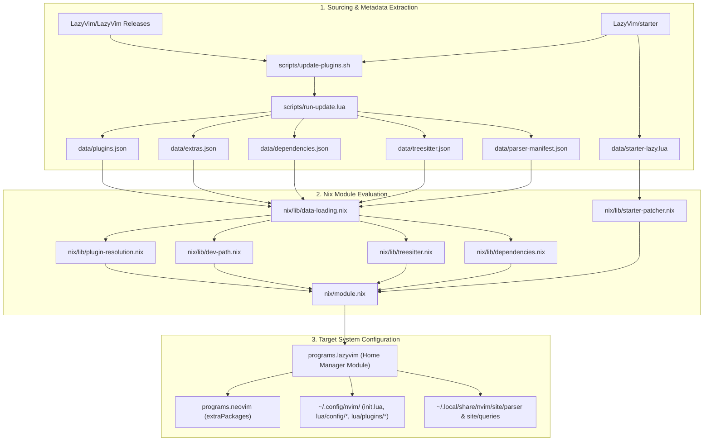
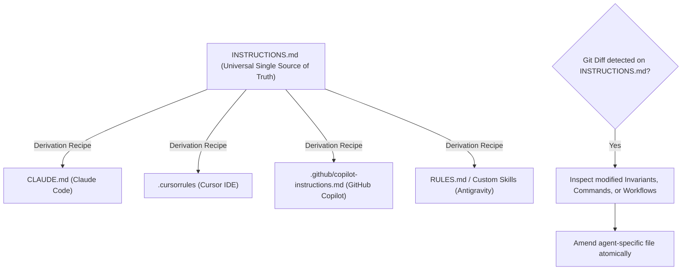

# INSTRUCTIONS.md: Universal AI Agent Guidelines & Architecture Manual

> **Universal Agent Scope**: This document is the authoritative, agent-agnostic Single Source of Truth (SSoT) for **[lazyvim-nix](file:///home/muhammadtalha/lazyvim-nix)**. Any AI coding assistant (including Claude Code, Cursor, GitHub Copilot, Google Antigravity, Roo Code, Windsurf, Aider, or custom agents) operating in this repository **must** read, follow, and uphold the instructions defined herein.
>
> **Agent Self-Derivation Protocol**: Every agent must use this document as the foundational source to craft its own agent-specific configuration file (e.g. `CLAUDE.md`, `.cursorrules`, `.github/copilot-instructions.md`, etc.). Whenever `INSTRUCTIONS.md` is modified, agents must review the diffs in this file and carefully amend their own instructions accordingly.

---

## 1. Repository Purpose & Architecture Overview

`lazyvim-nix` is a Nix flake providing [LazyVim](https://www.lazyvim.org/) for NixOS and Home Manager users. It bridges LazyVim's dynamic, plugin-heavy runtime ecosystem with Nix's pure, reproducible, read-only build environment.



### Key Components:
* **[flake.nix](file:///home/muhammadtalha/lazyvim-nix/flake.nix):** Flake outputs providing `homeManagerModules.default`, `lib.lazyConfig` helpers, dev shells, and the `lazyvim-update` package.
* **[nix/module.nix](file:///home/muhammadtalha/lazyvim-nix/nix/module.nix):** Main Home Manager module implementing `programs.lazyvim`.
* **[nix/options.nix](file:///home/muhammadtalha/lazyvim-nix/nix/options.nix):** Module options declarations (`enable`, `extras`, `extraPackages`, `configFiles`, `plugins`, `treesitterParsers`).
* **[nix/lib/](file:///home/muhammadtalha/lazyvim-nix/nix/lib):** Pure Nix logic for dependency resolution, Tree-sitter building, dev-path construction, starter patching, and config generation.
* **[data/](file:///home/muhammadtalha/lazyvim-nix/data):** Pinned plugin metadata, starter template, Tree-sitter parser manifest, and manual plugin mappings.
* **[scripts/](file:///home/muhammadtalha/lazyvim-nix/scripts):** Extraction scripts written in Bash and Lua running under headless Neovim.
* **[test/](file:///home/muhammadtalha/lazyvim-nix/test):** Multi-layered test suite (smoke, unit, integration, property, regression, and E2E).

---

## 2. The 7 Ironclad Invariants

Any code change, automated modification, or PR proposed by an AI agent **must strictly adhere** to these 7 invariants:

### Invariant 1: Never Enable Mason
* **Rule:** Mason (`mason.nvim`, `mason-lspconfig.nvim`, `mason-nvim-dap.nvim`) must **always remain disabled** (`enabled = false`).
* **Rationale:** Mason attempts to download mutable binaries into `~/.local/share/nvim/mason` at runtime, bypassing the Nix store and violating reproducibility.
* **Mechanism:** All LSP servers, linters, formatters, and debuggers must be injected into Neovim's `PATH` via `programs.neovim.extraPackages` through Nix derivations.

### Invariant 2: Dev-Path Symlink Architecture
* **Rule:** All Nix-resolved plugins are placed in a synthetic Nix store derivation (`lazyvim-dev-path`) and declared to `lazy.nvim` as `{ "<plugin-name>", dev = true, pin = true }`.
* **Rationale:** This informs `lazy.nvim` to load the plugin directly from the local filesystem path in `/nix/store/...` rather than attempting a `git clone` from GitHub.

### Invariant 3: Strict Separation of Generated vs. Manual Data
* **Rule:** **NEVER manually edit machine-generated data files:**
  - `data/plugins.json`
  - `data/extras.json`
  - `data/dependencies.json`
  - `data/treesitter.json`
  - `data/parser-manifest.json`
  - `data/starter-lazy.lua`
  - `data/starter-version.txt`
* **Exception:** Manual overrides and name translations **must only** be added to **[data/mappings.json](file:///home/muhammadtalha/lazyvim-nix/data/mappings.json)** or **[nix/plugin-overrides.nix](file:///home/muhammadtalha/lazyvim-nix/nix/plugin-overrides.nix)**.

### Invariant 4: Faithful Upstream Starter Patching
* **Rule:** Upstream `LazyVim/starter`'s `lua/config/lazy.lua` is tracked in `data/starter-lazy.lua`. Modifications needed for Nix compatibility must be cleanly injected via **[nix/lib/starter-patcher.nix](file:///home/muhammadtalha/lazyvim-nix/nix/lib/starter-patcher.nix)** without modifying the base file manually.
* **Patches Applied:**
  1. Replace upstream `spec = { ... }` with Nix-managed plugins (`dev = true`), disabled Mason, and pre-configured Tree-sitter.
  2. Set `checker.enabled = false` (Nix manages plugin updates).
  3. Set `change_detection.notify = false`.

### Invariant 5: Tree-sitter Query & Parser Coherence
* **Rule:** When `pluginSource = "latest"`, Tree-sitter parsers and queries must come from the same source of truth (`nvim-treesitter` pinned commit). Runtime parser compilation is intercepted by `_lazyvim_nix_treesitter.lua` and disabled because the Nix store is read-only.
* **Rationale:** Mismatched Tree-sitter queries and `.so` grammars lead to editor crashes or query compilation errors.

### Invariant 6: Pure Evaluation & Hermetic Builds
* **Rule:** Nix expressions must evaluate purely. Avoid undeclared inputs, unpinned hashes, or host filesystem dependencies inside derivations.

### Invariant 7: Focused, Single-Purpose Commits
* **Rule:** Do not bundle data updates (`data/*.json`) with Nix code refactors or feature changes in the same PR. Data updates are handled by the automated CI pipeline.

---

## 3. Agent Derivation & Amendment Protocol

AI agents operating in different environments (e.g. Claude Code CLI, Cursor IDE, GitHub Copilot) should maintain their own agent-specific instructions file derived from this manual.



### 3.1. Derivation Recipes for Specific Agents

#### Recipe A: For Claude Code (`CLAUDE.md`)
Create or update `CLAUDE.md` in the repository root with:
```markdown
# CLAUDE.md
Derived from INSTRUCTIONS.md. SSoT for Claude Code.

## Quick Commands
- Dev Shell: `nix develop`
- Smoke Test: `./test/run-tests.sh --smoke-only`
- Full Test Suite: `nix-build test/ -A runAll`
- Update Plugins: `nix develop --command ./scripts/update-plugins.sh --verify`
- Flake Check: `nix flake check`

## Core Invariants
- Mason is disabled; tools come from Nix extraPackages.
- Plugins are symlinked dev plugins (dev = true, pin = true).
- Never hand-edit data/plugins.json, data/extras.json, or data/dependencies.json.
- Manual mappings go into data/mappings.json.
```

#### Recipe B: For Cursor (`.cursorrules`)
Create or update `.cursorrules` in the repository root with:
```markdown
# Cursor Rules for lazyvim-nix
Derived from INSTRUCTIONS.md.
- Maintain pure Nix expressions and documentation integrity.
- Never edit files in data/ directly except data/mappings.json.
- When generating plugin specs, use flake lib helper: `inputs.lazyvim-nix.lib.lazyConfig`.
- Verify Nix evaluations using `nix-build test/ -A smokeTest`.
```

#### Recipe C: For GitHub Copilot (`.github/copilot-instructions.md`)
Create or update `.github/copilot-instructions.md` with instructions emphasizing Nix module patterns, option typing (`types.submodule`, `types.package`), and the Mason-disabled paradigm.

### 3.2. Amendment Protocol (When `INSTRUCTIONS.md` Changes)
Whenever a commit or PR modifies `INSTRUCTIONS.md`:
1. **Identify the Scope of Change:**
   - Did an Invariant change? Update the core rules in your agent file.
   - Did a test command change? Update the test instructions.
   - Did a file move or schema change? Update file paths and mapping formats.
2. **Atomic Update:** Amend the agent-specific file in the same PR or commit, keeping it in 100% agreement with `INSTRUCTIONS.md`.

---

## 4. Standard Operating Workflows

### Workflow 1: Updating to a New LazyVim Release
To update `lazyvim-nix` to track a new upstream LazyVim release:
1. Ensure you are inside the Nix development shell:
   ```bash
   nix develop
   ```
2. Run the update script with package verification enabled:
   ```bash
   ./scripts/update-plugins.sh --verify
   ```
3. Update LazyVim extras metadata:
   ```bash
   ./scripts/generate-extras-metadata.lua
   ```
4. Check **[data/mapping-analysis-report.md](file:///home/muhammadtalha/lazyvim-nix/data/mapping-analysis-report.md)** for unmapped plugins. If any exist, follow **Workflow 2**.
5. Run the full test suite:
   ```bash
   nix-build test/ -A runAll
   ```

### Workflow 2: Adding or Fixing a Plugin Mapping
When an upstream plugin cannot be automatically mapped to a `nixpkgs.vimPlugins` package:
1. Open **[data/mappings.json](file:///home/muhammadtalha/lazyvim-nix/data/mappings.json)**.
2. **For standard plugins (1-to-1 mapping):**
   ```json
   "zbirenbaum/copilot.lua": "copilot-lua"
   ```
3. **For multi-module plugins (e.g. `mini.nvim` modules):**
   ```json
   "nvim-mini/mini.files": {
     "package": "mini-nvim",
     "module": "mini.files"
   }
   ```
4. Re-run `./scripts/update-plugins.sh --verify` to re-extract with the new mapping.

### Workflow 3: Modifying Nix Module Code
When editing files in `nix/lib/`, `nix/options.nix`, or `nix/module.nix`:
1. Maintain purity and avoid hardcoding paths or dependencies.
2. Always provide detailed `builtins.throw` error messages with remediation instructions when an assertion fails.
3. Test evaluation immediately:
   ```bash
   nix-build test/ -A smokeTest
   ```
4. Run statix to catch Nix anti-patterns:
   ```bash
   nix develop --command statix check
   ```

---

## 5. Testing & Verification Guide

Always execute tests before committing changes. The test suite is organized into suites in the `test/` directory:

| Test Command | Purpose |
| :--- | :--- |
| `./test/run-tests.sh --smoke-only` | Quick smoke validation of module evaluation |
| `nix-build test/ -A smokeTest` | Fast Nix derivation evaluation check |
| `nix-build test/ -A unitTests` | Tests `nix/lib/` logic directly against real Nix values |
| `nix-build test/ -A integrationTests` | Tests module options, extras system, and conflicts |
| `nix-build test/ -A regressionTests` | Validates hash consistency and LazyVim spec compliance |
| `nix-build test/ -A propertyTests` | Tests edge cases, circular inputs, and error conditions |
| `nix-build test/ -A runAll` | Executes all test suites |
| `nix flake check` | Evaluates flake integrity and output schemas |

---

## 6. Code Style & Conventions

* **Nix Formatting:** 2-space indentation. Keep attrsets organized logically (imports, library imports, helpers, module definition).
* **Lua Code:** When embedding Lua in Nix strings, format cleanly with 2 spaces. When generating Lua specs from Nix attrsets, encourage users to use `inputs.lazyvim-nix.lib.lazyConfig` and `lib.generators.mkLuaInline`.
* **Documentation Links:** Always use relative markdown links or clickable `file:///` URLs when referencing repository artifacts.
